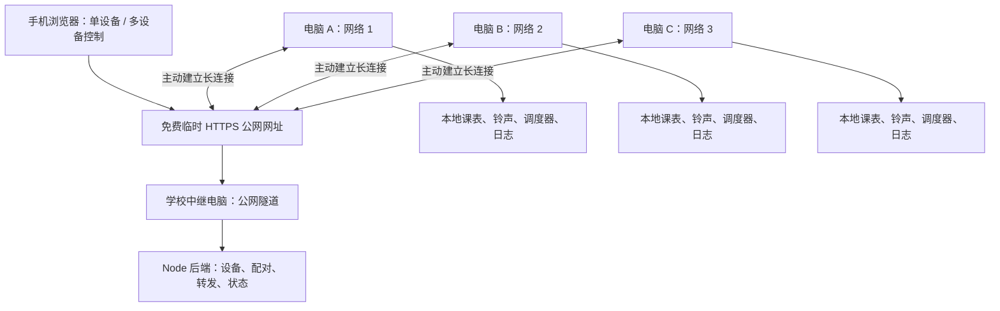

# 远程音乐控制与本地定时任务

## 网络拓扑

手机（任意网络）和电脑 A/B/C（可分处不同局域网），均主动连接同一个临时公网中继入口。学校中继电脑运行 Node 后端、控制页面和 cloudflared 隧道。局域网发现仅是可选的本地便捷入口，不承担跨网发现职责。

不购买服务器或域名；学校电脑承担服务器职责，临时公网入口仍依赖第三方网络服务。遵循已确认的使用约束：免费临时网址可变化，变化后手动更新手机入口及各远程电脑配置。无法仅凭旧网址自动知道一个新的随机网址。

## 控制、配置与执行的边界

即时播放/暂停/停止等指令仅发送给当前在线的目标电脑，不缓存过期播放命令，不在恢复网络后突然重放。
每条即时指令用 nonce 对应电脑端确认；每个任务变更用独立 reqId 对应保存确认，其他广播不能替代确认。对同一设备并发创建任务不能互相拿错结果。
成功、未下发、失败、结果未知分别显示。发出请求但尚未收到确认就断线，不能据此断言电脑未执行，也不能盲目重试下一首等非幂等操作。此轮没有自动重放未知指令。

定时任务先在目标电脑保存再确认，然后由本机调度器执行。手机关闭、单台电脑断网、中继退出、公网网址变化，都不删除已保存课表。电脑重启后由本地文件恢复调度，重连后补报课表及最近 2000 条执行历史。
离线电脑无法接收新配置，包括删除或停用；此轮不建立离线配置队列。批量操作是逐台独立操作，可能部分成功，不能作为跨设备原子事务。

## 媒体、时间与播放语义

铃声需提前存放到每台电脑并扫描曲库。批量按逻辑曲名选择，各电脑解析自己的本地路径，拒绝缺少或同名不唯一的铃声；保存任务时固定该电脑的文件路径。后续删除或移动文件会导致执行失败并记录日志。此轮不提供音乐自动上传或跨机分发。
定时和历史统一采用北京时间。单次任务保存绝对 runAt，批量单次任务使用同一个日期；周期任务使用 Asia/Shanghai 时区规则。各电脑系统时钟仍须正确，普通批量请求不能提供毫秒级音频同步。
单次铃声播完停止，歌单音乐保留自动下一首。播放器无法启动的动作返回失败；播放器已启动也不代表扬声器一定实际出声。
网络连接变化不停止调度和音乐播放；显式重启/退出程序会停止播放。音量及静音本地保存。

## 故障处理

| 故障 | 即时远程控制 | 已保存课表 | 恢复办法 |
| --- | --- | --- | --- |
| 手机关闭或断网 | 当前手机不可操作 | 继续 | 手机重新打开控制页 |
| 电脑 A 断网 | 仅 A 不可操作，B/C 可继续 | A 本地继续 | 自动重连；网址已变则手动更新 |
| 中继电脑关机/断网 | 全部远程操作不可用 | 各电脑本地继续 | 恢复中继并检查当前网址 |
| 临时网址变化 | 持有旧网址的远程设备不可连接 | 本地继续 | 手机与各远程电脑手动更新地址 |
| 网络半开、无有效消息 | 心跳超时后终止旧连接并重试 | 本地继续 | 默认约 55 秒检测，随后按重连间隔尝试 |
| 电脑重启/进程崩溃 | 重启期间不可操作 | 进程恢复后加载课表 | 启动程序；单次过期任务不顺延 |
| 电脑关机/休眠 | 不可操作 | 无法按时播放 | 保持开机、不休眠；迟到超过 30 秒不补响 |
| 文件缺失/播放器失败/音频故障 | 单台可能失败 | 不保证实际出声 | 查本机日志、文件、声卡和运行库 |

为避免过期铃声集中响起，错过的单次任务和迟到超过 30 秒的触发跳过。任务在播放前记录该次触发已消费，以降低崩溃后重复播放风险；若写盘后立即断电，可能未实际播放。这不是物理播放的“恰好一次”保证。此轮没有增加开机自启、自动唤醒、UPS 或音频硬件监测。

## 兼容与权限边界

这次改造仍基于现有 Node 电脑端，发布包为 Windows 10/11 x64，不构成 Win7 兼容实现。
当前原型保留原有全局配对/绑定设计，没有完成公网多用户身份认证及逐用户权限隔离。配对码、HTTPS 与加密载荷不能代替完整访问控制，不能将该原型描述为已经具备生产级公网安全。

## 验证范围

自动化测试使用独立临时目录与多个真实 Agent 进程，验证并发任务确认、单台离线其他设备继续操作、离线任务触发、恢复连接上传历史、单次任务不顺延、心跳超时和音频启动失败回执。定时执行使用停止动作避免测试发声。
这些测试不模拟真实的三地网络链路、NAT、防火墙、运营商限制，也不验证物理扬声器出声；正式交付需在目标网络与电脑试听验证。
